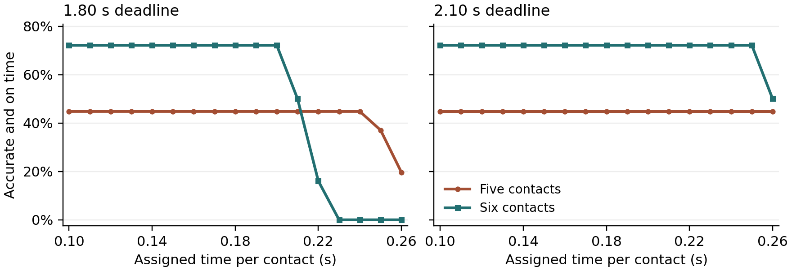

# Timing a sixth rim contact when centering an elliptical aperture

Vedant Thaker  
Independent Researcher, Jeffersonville, Indiana, USA  
vedant.thaker1602@gmail.com

21 November 2026

### Abstract

How much time should a probe spend improving the estimated center of an aperture before moving there? For an ellipse with unknown shape, four axial contacts can leave the center ambiguous. A fifth, oblique contact identifies a generic noiseless conic, while the opposite endpoint supplies redundancy. Across 3,200 simulated offsets of one ellipse, that sixth endpoint lowered median center error from 0.294 to 0.139 mm. At a center tolerance of 0.25 mm and a deadline of 1.8 s, it gained 876 on-time accurate corrections when each contact cost 0.18 s, then lost 920 when each cost 0.22 s. The change follows from the travel left after probing. A fixture-specific timing inequality makes the comparison transferable to a device once probe duration and travel speed have been measured.

## Four contacts can leave two different centers

A probe approaching an aperture can spend its remaining time collecting a better coordinate or moving toward the coordinate it already has. The two actions share the same deadline. This note first characterizes the shape information available from radial contacts, then derives the travel budget and tests both calculations on matched noisy ellipses. The outcome is a center estimate reached within a specified time.

Take an ellipse with center c and positive-definite symmetric matrix Q, defined by (x − c)ᵀQ(x − c) = 1. Intersect it with the horizontal and vertical axes through the origin. The average horizontal intersection coordinate is mₓ = cₓ + (Qₓᵧ/Qₓₓ)cᵧ. The vertical average is mᵧ = cᵧ + (Qₓᵧ/Qᵧᵧ)cₓ. These expressions follow from the sum of the two quadratic roots along each axis. When Q is known, the two equations recover c because the coefficient determinant is det(Q)/(QₓₓQᵧᵧ) > 0. Separate midpoints are exact for axis-aligned ellipses and can be displaced for rotated ellipses.

With unknown Q the four measured points need not identify even the center. The four intersections (−1, 0), (3, 0), (0, −1) and (0, 3) satisfy x² + 2bxy + y² − 2x − 2y − 3 = 0 for every |b| < 1. The centers at b = 0 and b = 1/2 are (1, 1) and (2/3, 2/3), respectively. A fifth generic point adds the remaining projective conic constraint [1]. Noise can make the resulting center ill-conditioned. The sixth-contact comparison below uses the same ellipse-constrained least-squares estimator [2] at both sample sizes.

## How long can a sixth touch take?

Write τ for the duration of an approach, trigger and return cycle, k for the number of contacts, t₀ for fixed overhead, v for correction speed, and rₖ for the length of the commanded correction. A deadline D is met when kτ + t₀ + rₖ/v ≤ D. Equivalently, that fixture allows τ ≤ (D − t₀ − rₖ/v)/k. The accuracy test additionally requires the fitted center to fall within ε of the true center. A system with variable contact times can replace kτ by the sum of its measured cycle durations. Acceleration and overlap between travel and sensing would change the time model.

For illustration take D = 1.80 s, t₀ = 0.42 s, v = 30 mm/s and τ = 0.22 s. The available correction is then 8.4 mm after five contacts and 1.8 mm after six. For an ideal estimator and true offsets distributed uniformly in area over a disk of radius 4.5 mm, the latter travel radius covers (1.8/4.5)² = 16% of starts. Changing D to 2.10 s increases sixth-touch travel to 10.8 mm. These constants illustrate a crossover and have no instrument calibration.

## A paired test with unknown shape

Eight independently seeded blocks of 400 fixtures use ellipses with semiaxes 7 and 3.5 mm rotated by 35°. Translation is sampled uniformly in the 4.5 mm disk. The first two probes traverse the horizontal and vertical axes. A third line at 45° passes through the coordinate defined by their measured midpoints. A fair random choice assigns one oblique endpoint as the fifth contact. The other supplies the sixth. Each probe has ±12 mm range and independent Gaussian coordinate noise with standard deviation 0.12 mm along the line. The same first five measurements enter both fits. These dimensions and error law expose the effect of oblique contacts under one geometry.

The fitting code translates and scales the observed endpoints, solves for the conic with the normalization 4AC − B² = 1, and extracts the stationary point of the fitted quadratic [2]. The estimator has no access to the true axes, center or disk boundary. Error is the Euclidean distance to the true center. Correction length is measured from the initial origin to the estimated center. A fixture counts only if both its error and its modeled time meet their cutoffs. The surface spans 17 assigned contact times from 0.10 to 0.26 s, three tolerances (0.10, 0.25, 0.50 mm), and two deadlines (1.80, 2.10 s).

## Accuracy improves before timing enters

Every fixture yielded observable endpoints and finite fitted centers. At five contacts the median and 90th-percentile errors were 0.294 and 2.052 mm. With six they were 0.139 and 0.596 mm. The five-point fit produced a long tail. Sixty-three errors exceeded 10 mm and one exceeded 2,400 mm. Two six-point errors exceeded 10 mm. All are retained. A practical system might constrain the estimated center to a calibrated work envelope.

At 0.25 mm tolerance, the purely geometric pass counts were 1,434 and 2,310. At the 1.80 s deadline, the timing model left every geometrically accurate six-contact estimate on time at τ = 0.20 s. At τ = 0.21 s only 1,602 six-contact estimates met both criteria. At 0.22 s only 514 did. The per-block net gain at 0.18 s ranged from 98 to 117 out of 400. The per-block net loss at 0.22 s ranged from 97 to 130. At those same two times the direction also reversed for the 0.10 mm and 0.50 mm tolerances.

| Deadline (s) | Touch (s) | Both | Five only | Six only | Neither | Net six |
| --- | --- | --- | --- | --- | --- | --- |
| 1.80 | 0.18 | 1,356 | 78 | 954 | 812 | +876 |
| 1.80 | 0.21 | 1,041 | 393 | 561 | 1,205 | +168 |
| 1.80 | 0.22 | 382 | 1,052 | 132 | 1,634 | −920 |
| 2.10 | 0.22 | 1,356 | 78 | 954 | 812 | +876 |
Table 1. Accuracy within 0.25 mm and correction before the deadline. Each row partitions the same 3,200 fixtures. Net six is six-only minus five-only.

## What would establish a hardware crossover?

Real probes have a finite tip, and alignment and compensation can displace a measured rim point [3]. Approach duration can also depend on the direction or distance of the next contact. The NIST peg-in-hole archive provides registered target coordinates and insertion outcomes for a different experiment [4]. It does not record the five- or six-touch sequences needed to test these estimates. No claim about insertion success or measured cycle time follows from the present note.

The decisive experiment pairs both fits on the same physical trajectories, compares their centers with an independent survey, and times commands through completed correction. Measuring the dependence of cycle time on approach direction would allow the per-fixture inequality to use observed durations. A held-out set of apertures would then show whether an extra touch changes the number of accurate corrections that arrive on time.

## Data and code availability

The accompanying supplement provides the source, 3,200 paired fixture records, all timing tables, the reference checks and a physical replication protocol. The geometry implementation builds on the public study code at https://github.com/VEDANT1602/aperture-contact-localization/tree/564b3879d618f6053d90dfd42009a98d37b4ad89 .

[Study files, software and source records](https://github.com/VEDANT1602/aperture-contact-localization/tree/main/study)

## Author and disclosures

Vedant Thaker is the sole author and set the research question. OpenAI Codex assisted with developing the geometric tests, checking the timing assumptions and drafting the note.

This research received no specific grant from any funding agency in the public, commercial, or not-for-profit sectors. The author declares no competing interests.

## References

[1] R. Hartley and A. Zisserman. Multiple View Geometry in Computer Vision, 2nd ed. Cambridge University Press, 2004, §2.2.3, p. 31. <https://doi.org/10.1017/CBO9780511811685>

[2] A. Fitzgibbon, M. Pilu and R. B. Fisher. Direct least square fitting of ellipses. IEEE Transactions on Pattern Analysis and Machine Intelligence 21(5), 476–480, 1999. <https://doi.org/10.1109/34.765658>

[3] J. Stone, B. Muralikrishnan and C. Sahay. Geometric effects when measuring small holes with micro contact probes. Journal of Research of the National Institute of Standards and Technology 116(2), 573–587, 2011. <https://doi.org/10.6028/jres.116.006>

[4] National Institute of Standards and Technology. Peg-in-Hole Data. Experimental protocol, pose files and insertion pass/fail tables. <https://doi.org/10.18434/T4/1500929>
